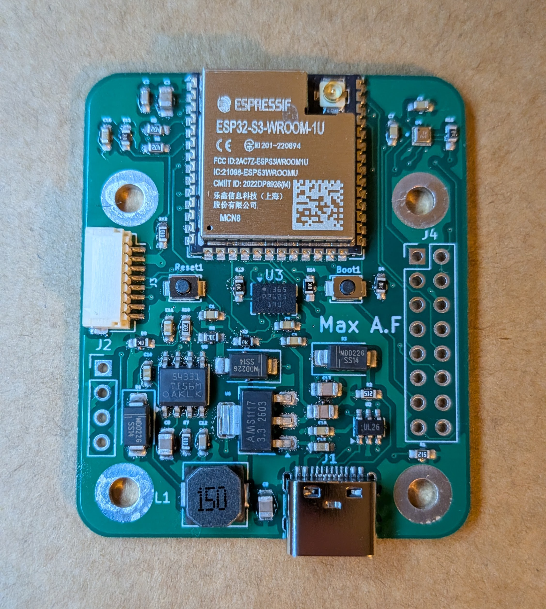
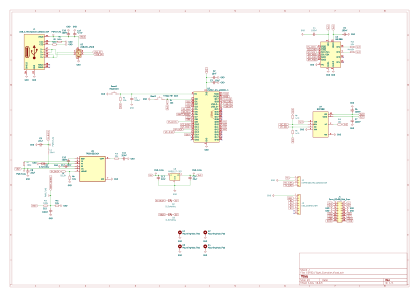
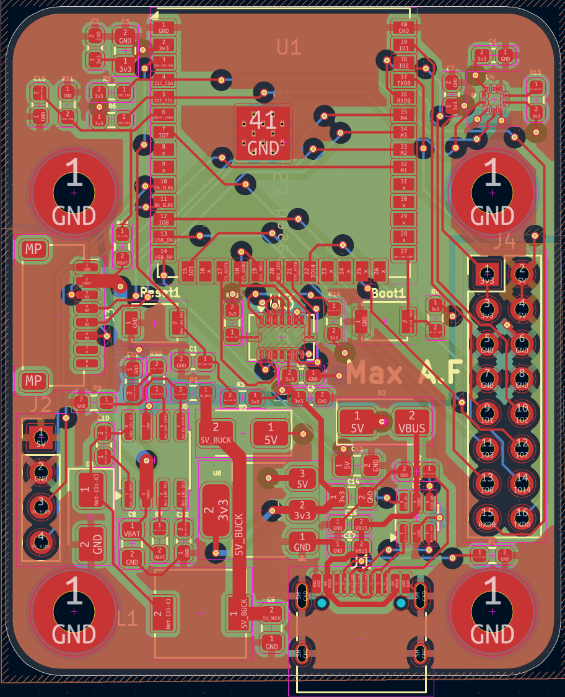

# ESP32-S3 Custom Flight Controller

A custom-designed drone flight controller built from the ground up around the ESP32-S3 microcontroller. This project is a work-in-progress, covering everything from custom PCB design in KiCad to low-level sensor drivers and Web Serial 3D visualization.

## Hardware Features
- **Microcontroller**: ESP32-S3-WROOM-1 (Dual-Core Xtensa LX7, 240MHz)
- **IMU**: Bosch BMI088 (6-axis accelerometer & gyroscope) via SPI
- **Barometer**: Bosch BMP388 via I2C
- **Power System**: Onboard TPS54331 buck converter (battery Vin to 5V) & AMS1117-3.3 LDO
- **PCB**: Custom 4-layer PCB designed in KiCad, hand-soldered SMD components.

## Assembled PCB

## Hardware Design Process

### 1. Schematic
The schematic was designed in KiCad and ordered as a 4-layer PCB from JLCPCB.

### 2. PCB Layout & Stackup
The layout was routed in KiCad with the following dedicated 4-layer stackup:
* **Layer 1 – Top Layer (F.Cu):** Primary signal layer used for component placement (ESP32-S3, IMU, Barometer) and high-speed SPI/I2C trace routing.
* **Layer 2 – Inner Layer 1 (In1.Cu):** Dedicated internal Ground Plane (GND) providing low-impedance return paths and EMI shielding for sensitive sensors.
* **Layer 3 – Inner Layer 2 (In2.Cu):** Dedicated Power Plane with split power zones distributing clean 3.3V and 5V power across the board.
* **Layer 4 – Bottom Layer (B.Cu):** Secondary signal and ground layer used for remaining routing and bottom-side thermal dissipation.

## Bill of Materials (BOM)

### Integrated Circuits & Active Components
| Designator | Component / Part | Package | Qty | Function |
| :--- | :--- | :--- | :--- | :--- |
| **U1** | ESP32-S3-WROOM-1 | SMD Module | 1 | Main Flight Controller MCU |
| **U3** | Bosch BMI088 | LGA-16 | 1 | 6-Axis IMU (SPI) |
| **U4** | Bosch BMP388 | LGA-10 | 1 | Barometric Pressure & Altitude Sensor (I2C) |
| **U5** | TI TPS54331DG4 | SOIC-8 | 1 | Step-Down Buck Converter (Battery Vin to 5V) |
| **U6** | AMS1117-3.3 | SOT-223 | 1 | Low-Dropout (LDO) Linear Voltage Regulator (3.3V) |
| **U2** | USBLC6-2SC6 | SOT-23-6 | 1 | Low-Capacitance ESD Protection Array (USB) |
| **D1, D2, D3** | SS14 / SS34 | SMA (DO-214AC) | 3 | Schottky Barrier Diodes |
| **L1** | 15 µH (e.g. LVS606020) | SMD (~6x6 mm) | 1 | Power Inductor for Buck Converter |

### Connectors & Switches
| Designator | Description | Qty | Function |
| :--- | :--- | :--- | :--- |
| **J1** | USB-C 12-pin (TYPE-C-31-M-12) | 1 | USB Data / Programming & 5V Power |
| **J3** | JST-SH 8-Pin SMD (SM08B-SRSS-TB) | 1 | 4-in-1 ESC Interconnect (PWM / DSHOT signals) |
| **J2, J4** | 2.54mm Pitch Pin Headers | 2 | RC Receiver (UART) & Expansion / Debug pins |
| **SW1, SW2** | SMD Tactile Push Buttons | 2 | Bootloader & Hardware Reset |

### Passives Summary
* **Capacitors:**
  * `100 nF (0603)` — **8 pcs** (Decoupling for MCU, sensors, and regulators)
  * `10 nF (0603)` — **2 pcs** (Noise filtering / compensation)
  * `3.3 nF (0603)` — **1 pc** (Buck converter compensation loop)
  * `4.7 µF (0603)` — **1 pc** (Bulk decoupling)
  * `10 µF (0805)` — **1 pc** (LDO input/output stabilization)
  * `22 µF (0805)` — **4 pcs** (High-capacitance power rail smoothing)
* **Resistors (all 0603):**
  * `10 kΩ` — **7 pcs** (Pull-ups & boot mode configuration)
  * `4.7 kΩ` — **2 pcs** (I2C bus pull-ups for SDA / SCL)
  * `5.1 kΩ` — **2 pcs** (USB-C CC line pull-downs for 5V power negotiation)
  * `100 kΩ` — **2 pcs** (Voltage dividers & enable lines)
  * `30 kΩ` — **1 pc** (Feedback network)
  * `52.3 kΩ` — **1 pc** (High-precision feedback resistor for buck regulator)

## Software / Firmware
The firmware is written in C++ (Arduino framework) and features:
- **Raw SPI Communication**: Bypasses bloated libraries to communicate directly with the BMI088 registers, resolving complex ESP32 HAL macro conflicts.
- **Sensor Fusion**: Implements a custom Complementary Filter combining high-speed gyro data with accelerometer gravity vectors for stable, drift-free Pitch and Roll calculation.
- **Barometric Altimeter**: Features an auto-zeroing routine on startup to establish local ground-level pressure before calculating relative altitude in meters.

## 3D Web Visualizer
Included in the `tools/` directory is a custom HTML5/Three.js 3D drone visualizer. 
It uses the modern **Web Serial API** to connect directly to the flight controller via USB (no servers required) and renders the drone's orientation in real-time at 60fps based on the live IMU telemetry.

## Directory Structure
- `hardware/`: KiCad schematics and PCB layout files.
- `firmware/FlightController/`: The main C++ Arduino sketch containing sensor drivers and mathematical filters.
- `tools/`: Contains `3D_Viewer.html` (Double-click to open in a modern browser).

## Roadmap / To-Do
- [x] PCB Design & Assembly
- [x] I2C & SPI Bring-up
- [x] Raw IMU & Barometer Data Extraction
- [x] Sensor Fusion (Complementary Filter)
- [x] Real-time 3D Visualization
- [ ] PID Controller Implementation
- [ ] ESC Motor Output (DSHOT/PWM)
- [ ] Radio Receiver Integration (ExpressLRS/Crossfire)

*Hardware designed from scratch by Max. Firmware and 3D visualization developed using AI-assisted pair programming.*
